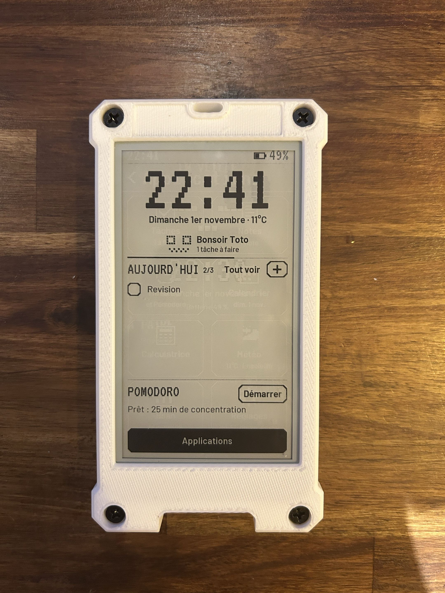

# Pamk Brik V0

**A minimalist e-paper phone you print and build yourself.** Tasks, notes, focus timer, calendar,
weather, habits and a weekly review, and nothing else to scroll.

*Version française plus bas.*

> **V0 has no SIM card, no calls and no sound yet.** Its interface is in **English or French**.
> Calls come with V1.

## What it does

| App | What you get |
| :--- | :--- |
| Home | big clock, date, next appointment, today's tasks, quick capture |
| Tasks | due date and time, reminder at the time (black screen, even asleep), repeat daily / weekdays / weekly / monthly |
| Notes | write and read notes page by page, pin the important ones to the sleep screen, search tasks and notes |
| Pomodoro & timer | work / break cycles, pick the task you work on, focus mode, end shown even if the phone was asleep |
| Weekly review | focus minutes per day, pomodoros, tasks done, streak |
| Calendar & agenda | month view, your Google Calendar (or any iCal link) read-only |
| Weather, habits, breathing, converter, calculator | small everyday tools |
| Access from your computer | web page on your Wi-Fi for tasks, notes, backup and firmware update, protected by a 4-digit code |

## What you need

| Part | Details |
| :--- | :--- |
| Board | **LILYGO T5 4.7" E-paper V2.3 ESP32-S3**, option **"With Touch Glass"**, **"No Solder Pin"** (LilyGO code H716) |
| Battery | LiPo **103450**, 3.7 V, 2000 mAh, **JST PH 2.0** plug (check the plug before connecting) |
| Printed parts | **`Coque V4`** (shell) and **`Cadre V4`** (frame), in the repository root; print profile `PamkBrik.3mf` |
| Screws | 4 × **M4 × 12** and 4 × **M4 heat-set inserts** |

V0 needs no push button: everything is done on the touch screen.

## Install the firmware

Everything is in [`firmware/README.md`](firmware/README.md) (in French): Arduino IDE with the
**esp32 2.0.17** core, the **LilyGo-EPD47 1.1.0** library (without its dependencies) and
**ArduinoJson**, board settings, first start.

## Repository

| Folder | Content |
| :--- | :--- |
| `firmware/` | Arduino sketch (`PamkPhone/`), tools, setup guide |
| `docs/` | decisions, wiring, mechanical data of the parts |
| `cad/` | an earlier parametric case (CadQuery), its exports and checks |
| root | the final V4 case: Inventor files (`Ensemble V4`, `Coque V4`, `Cadre V4`) and print files |
| `anciennes_versions/` | earlier case versions (V2, V3, first shells), kept for history |
| `img/` | photos of the printed phone |

## Licence

**GPL-3.0** for the whole repository: see [`LICENSE`](LICENSE) and [`NOTICE.md`](NOTICE.md). The name
"Pamk Brik" is not covered: a modified version must use another name.

Made by Thomas Bernon, maker of **Pamk**, a voice-controlled desk robot.

---

## En français

**Un téléphone minimaliste à écran e-paper, à imprimer et à monter soi-même** : tâches avec rappels,
notes, Pomodoro et mode concentration, calendrier, agenda, météo, habitudes et bilan de la semaine.

- **La V0 n'a ni carte SIM, ni appels, ni son.** Les appels arrivent avec la V1. Interface en
  français ou en anglais (Réglages → Langue).
- **Matériel** : carte LILYGO T5 4.7" E-paper V2.3 ESP32-S3 « With Touch Glass » (H716), batterie
  LiPo 103450 de 2000 mAh (prise JST PH 2.0), les pièces imprimées `Coque V4` et `Cadre V4`
  (profil d'impression `PamkBrik.3mf`), 4 vis M4 × 12 et 4 inserts M4 à chaud.
- **Installation** : tout est dans [`firmware/README.md`](firmware/README.md).
- **Licence** : GPL-3.0 ([`LICENSE`](LICENSE), [`NOTICE.md`](NOTICE.md)). Le nom « Pamk Brik » n'est
  pas couvert par la licence.
