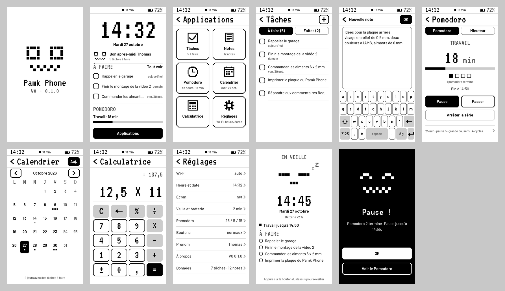

# Pamk Phone V0 — firmware

Firmware Arduino du Pamk Phone V0 pour la **LILYGO T5 4.7" E-paper V2.3 ESP32-S3** tactile
(code LilyGO H716). Écran e-paper 960 × 540 utilisé **en portrait (540 × 960)**, interface en
français, look Pamk (noir, blanc, gris, coins coupés, visage pixel).

Pas de carte SIM ni de son en V0. **Aucune liaison avec Pamk** (palier réservé de la campagne) :
les tâches et notes ont seulement un identifiant et une date de modification pour une
synchronisation future.



## Ce que fait la V0

| Appli | Fonctions |
|---|---|
| **Accueil** | grande horloge, date, Pamk et salutation (avec ton prénom), 3 prochaines tâches à cocher, état du Pomodoro, bouton Applications |
| **Applications** | 6 grandes tuiles avec icônes pixel |
| **Tâches** | onglets « À faire » / « Faites », ajout au clavier, cocher, détail : modifier le titre, échéance (aucune, aujourd'hui, demain, +7 j, ±1 jour), dates de création et de modification, suppression (aussi par appui long) |
| **Notes** | liste (la plus récente d'abord, aperçu), lecture page par page, écriture et modification au clavier (4000 caractères), suppression |
| **Pomodoro** | travail / pause / grande pause réglables, pause lancée automatiquement, carrés de progression des cycles, fin affichée sur un **écran noir** (même si le téléphone dormait) |
| **Minuteur** | durées rapides (1 à 60 min), ± 1 / ± 5 min, pause, fin visuelle |
| **Calendrier** | vue du mois (aujourd'hui en noir, petits carrés = tâches à faire), toucher un jour = ses tâches, ajout d'une tâche à ce jour |
| **Calculatrice** | + − × ÷ avec priorités, %, ±, virgule, aperçu du résultat, effacer (appui long = tout effacer) |
| **Réglages** | Wi-Fi (scan, mot de passe au clavier, 4 réseaux mémorisés, mode éteint / auto / toujours), heure (NTP, fuseau, réglage à la main), écran (retourner, mise à jour pixel par pixel ou douce, image complète automatique optionnelle, nettoyage, mire de gris), veille et batterie, Pomodoro, boutons (inverser, test), prénom, à propos, données (tout effacer) |
| **Système** | barre d'état (heure, Pomodoro en cours, Wi-Fi, batterie), clavier AZERTY (accents é è ê ë à â ç ù û î ï ô œ æ…, chiffres, symboles), veille légère entre deux actions, **sommeil profond** avec écran de veille qui reste affiché (Pamk endormi, heure, tâches), heure de l'écran de veille mise à jour toutes les 15 min, écran « éteint », écran batterie vide, console série |

## 1. Ce qu'il faut installer

**Rien à changer dans ton cœur ESP32** : la bibliothèque de l'écran demande le cœur
**esp32 2.0.17**, celui que tu as déjà pour Pamk (README de LilyGO et leur intégration
continue : `arduino-cli core install esp32:esp32@2.0.17`).

Bibliothèques :

| Bibliothèque | Version | Chez toi |
|---|---|---|
| **LilyGo-EPD47** | **1.1.0** | **à installer, SANS ses dépendances** |
| ArduinoJson | 7.x | déjà là (7.4.3) |

LilyGo-EPD47 annonce SensorLib, Button2 et ArduinoJson comme dépendances, mais seuls ses
exemples s'en servent : son code (`src/`) n'a besoin que du cœur. Le firmware a son propre
pilote du tactile GT911, donc **pas de SensorLib ni de Button2**. J'ai vérifié qu'aucun
fichier de Pamk n'inclut un en-tête de même nom (`utilities.h`, `touch.h`, `epd_driver.h`…) :
l'installer ne change rien pour Pamk.

### Avec l'IDE Arduino

Gestionnaire de bibliothèques → chercher **LilyGo-EPD47** → version **1.1.0** → Installer →
choisir **« Installer sans les dépendances »** (« Install without dependencies »).

### Ou en ligne de commande (PowerShell)

L'`arduino-cli` livré avec l'IDE, avec la même configuration que l'IDE :

```powershell
$cli = "$env:LOCALAPPDATA\Programs\Arduino IDE\resources\app\lib\backend\resources\arduino-cli.exe"; $cfg = "$env:USERPROFILE\.arduinoIDE\arduino-cli.yaml"; & $cli --config-file $cfg lib install "LilyGo-EPD47@1.1.0" --no-deps
```

### Variante sans rien installer du tout

Cloner la bibliothèque à côté du projet et la donner au compilateur avec `--library`
(c'est ce que fait l'intégration continue de LilyGO) :

```powershell
git clone --branch v1.1.0 --depth 1 https://github.com/Xinyuan-LilyGO/LilyGo-EPD47.git A:\bernon\Robotique\Pamk_Phone\firmware\_ref\LilyGo-EPD47-1.1.0
```

puis ajouter `--library A:\bernon\Robotique\Pamk_Phone\firmware\_ref\LilyGo-EPD47-1.1.0` à la
commande `compile` ci-dessous. (`firmware/_ref/` est ignoré par git.)

## 2. Réglages de la carte

| Outils (IDE) | Valeur | Obligatoire |
|---|---|---|
| Carte | **ESP32S3 Dev Module** | oui |
| USB CDC On Boot | **Enabled** | oui (console série par l'USB) |
| USB Mode | **Hardware CDC and JTAG** | oui |
| Flash Size | **16MB (128Mb)** | oui |
| Partition Scheme | **16M Flash (3MB APP/9.9MB FATFS)** | oui (les données vont dans la partition FAT) |
| PSRAM | **OPI PSRAM** | oui (sinon erreur de compilation volontaire) |
| Flash Mode | QIO 80MHz | défaut |
| CPU Frequency | 240MHz (WiFi) | défaut |
| Upload Mode | UART0 / Hardware CDC | défaut |
| Core Debug Level | None | conseillé |

Ce sont les réglages du README de LilyGO (« Arduino IDE Setting »), vérifiés dans le
`boards.txt` de ton cœur 2.0.17.

## 3. Compiler et téléverser (PowerShell)

C'est toi qui compiles et flashes. En ligne de commande (remplace `COM5` par ton port,
donné par `board list`) :

```powershell
$cli = "$env:LOCALAPPDATA\Programs\Arduino IDE\resources\app\lib\backend\resources\arduino-cli.exe"; $cfg = "$env:USERPROFILE\.arduinoIDE\arduino-cli.yaml"; $fqbn = "esp32:esp32:esp32s3:CDCOnBoot=cdc,USBMode=hwcdc,FlashSize=16M,PartitionScheme=app3M_fat9M_16MB,PSRAM=opi"
```

```powershell
& $cli --config-file $cfg board list
```

```powershell
& $cli --config-file $cfg compile --fqbn $fqbn A:\bernon\Robotique\Pamk_Phone\firmware\PamkPhone
```

```powershell
& $cli --config-file $cfg upload -p COM5 --fqbn $fqbn A:\bernon\Robotique\Pamk_Phone\firmware\PamkPhone
```

```powershell
& $cli --config-file $cfg monitor -p COM5 -c baudrate=115200
```

**Si le port n'apparaît pas** (FAQ LilyGO) : câble USB branché, maintenir **BOOT**, appuyer
sur **RST**, relâcher RST, puis relâcher BOOT ; téléverser ; appuyer sur RST à la fin.

## 4. Premier démarrage

1. Visage de Pamk et « Démarrage… ». La toute première fois, la partition FAT de 9,9 Mo est
   formatée : l'écran peut rester figé un moment, c'est normal.
2. L'accueil s'affiche avec **« --:-- » et « Heure à régler : connecte le Wi-Fi »** tant que
   l'heure n'a jamais été réglée par ce firmware (toucher l'horloge ouvre Réglages → Wi-Fi).
   L'heure trouvée dans l'horloge RTC de la carte à la livraison n'est **pas** utilisée : la
   démo d'usine LilyGO l'écrit en heure locale de son propre fuseau (d'où les ~8 h de décalage
   vus au premier essai).
3. **Wi-Fi** : Applications → Réglages → Wi-Fi → Chercher un réseau → toucher ton réseau →
   mot de passe au clavier → OK. **La première connexion Wi-Fi met l'heure à jour** : en mode
   « auto », le téléphone se connecte, récupère l'heure (NTP, fuseau Europe/Paris par défaut),
   l'écrit **en UTC** dans l'horloge RTC de la carte avec une signature « Pamk Phone », puis
   **éteint le Wi-Fi**. Ensuite l'heure reste juste sans Wi-Fi, après un redémarrage, une veille
   ou même une coupure de la batterie (l'horloge a sa propre pile). Le réseau est mémorisé (en
   flash, jamais dans le code).
   Sans Wi-Fi : Réglages → Heure et date → réglage manuel (écrit aussi l'horloge en UTC).
   Par la console : `wifi connecter MonReseau MonMotDePasse` (SSID sans espace).
4. Réglages → Prénom, pour « Bonjour Thomas ».

## 5. Utilisation

| Action | Effet |
|---|---|
| Marche, appui court | veille (écran de veille, sommeil profond) ; réveil par un appui |
| Marche, appui long (2 s) | éteint (écran « Éteint ») ; rallumer = maintenir le bouton ~2 s |
| Volume +, court | suivant : page suivante, mois suivant, + 1, curseur à droite au clavier |
| Volume −, court | précédent : page précédente, mois précédent, − 1, curseur à gauche |
| Volume + long | accueil |
| Volume − long | retour |
| Volume + et − ensemble | accueil |
| Chevron en haut à gauche | retour (appui long : accueil) |
| Glisser depuis le bord gauche vers la droite | retour |
| Glisser à gauche / à droite, en haut / en bas | page suivante / précédente |
| Appui long sur une tâche ou une note | supprimer (avec confirmation) |

Le clavier : `?123` chiffres, `àç` accents, `=\<` symboles, flèche = majuscule (un appui =
une lettre, deux = verrouillé), appui long sur effacer = efface le mot. Taper à la fin du
texte ne fait **jamais flasher** l'écran (seuls des pixels noircissent) ; déplacer le curseur
(toucher le texte, ou volume + / −) ne change que les pixels du curseur.

## 6. Console série (115200 bauds)

| Commande | Effet |
|---|---|
| `aide` | liste des commandes |
| `etat` | version, cause du réveil, heure, batterie, Wi-Fi, tactile, RTC, mémoire, stockage, écran |
| `taches`, `ajouter <titre>`, `fait <n>` | lister, ajouter, cocher / décocher |
| `notes`, `note <texte>` | lister, ajouter |
| `veille`, `eteindre`, `redemarrer` | énergie |
| `batterie` | mesure maintenant (mV, %, USB) |
| `wifi`, `wifi scan`, `wifi connecter <ssid> <mdp>`, `wifi oublier <n>`, `wifi sync`, `wifi off` | Wi-Fi |
| `heure`, `heure 2026-10-27 14:32`, `heure ntp`, `fuseau <règle POSIX>` | heure |
| `rafraichir`, `nettoyer` | image complète, nettoyage anti-fantôme |
| `tactile`, `boutons` | affiche les coordonnées touchées / les appuis (pour les tests) |
| `memoire`, `fichiers`, `reglages` | diagnostic |
| `export` | **sauvegarde** : toutes les tâches et notes en JSON |
| `legere on/off` | veille légère |
| `reset` puis `reset oui` | efface tout |

Pendant le débogage : la veille légère se coupe toute seule quand un ordinateur est
branché en USB, et la veille automatique aussi (réglable : Réglages → Veille et batterie).

## 7. À tester en premier sur la vraie carte

Dans l'ordre (les points les plus incertains d'abord) :

1. **Orientation** : l'USB-C doit être en bas (valeur par défaut corrigée le 27/10 :
   `ORIENTATION_DEFAUT = 0`). L'ancienne valeur enregistrée par la première version est
   effacée tout seul au premier démarrage (réglages « version 2 », voir `parametres.cpp`).
   Si besoin : Réglages → Écran → Retourner l'écran.
2. **Tactile** : toucher les 4 coins de l'accueil avec `tactile` actif dans la console ; le
   point touché doit correspondre au dessin. Le tactile suit la même orientation que l'image.
   Si c'est en miroir ou tourné, changer `TACTILE_ECHANGER_XY` / `TACTILE_MIROIR_X` /
   `TACTILE_MIROIR_Y` dans `config.h`.
3. **Rendu pixel par pixel** : cocher une tâche, taper du texte, changer de page : seuls les
   pixels qui changent doivent bouger, **plus jamais de rectangle noir**. Dans Réglages →
   Écran, la dernière ligne indique le mode, le nombre de passes et la durée de la dernière
   mise à jour (aussi `etat` dans la console). S'il reste des traces : Réglages → Écran →
   Nettoyer l'écran, ou passer `MAJ_CYCLES_PIXELS` à 2 dans `config.h`.
4. **Heure** : au premier démarrage, « Heure à régler : connecte le Wi-Fi » ; après la
   connexion, l'heure de Paris s'affiche (console `heure` : source « NTP »). Puis `redemarrer`
   sans Wi-Fi : l'heure doit rester juste (source « RTC »).
5. **Veille et réveil** : passage à l'écran de veille sans rectangle noir ; au réveil, retour
   à l'appli sans flash de tout l'écran ; après 15 min de veille, seuls les chiffres de
   l'heure et la batterie de l'écran de veille changent. Courant en veille (LilyGO annonce
   ~380 µA).
6. **Boutons** : Réglages → Boutons → zone « Test » (et `boutons` dans la console).
   Volume + / − inversés → « Inverser volume ». Marche court = veille, long = éteint.
7. **Batterie** : comparer `batterie` au multimètre sur `BAT+` ; corriger avec
   `BATTERIE_CORRECTION_MV`. Vérifier la **polarité du connecteur** avant de brancher.
8. **Horloge RTC** (`etat` → « RTC : PCF8563 ») : débrancher / rebrancher la batterie, l'heure
   doit rester juste.
9. **Mode doux** (Réglages → Écran → Mise à jour → douce) : aucun clignotement ; à comparer
   au mode par défaut pour les traces. Mire de gris (16 niveaux), nettoyage.
10. **Veille légère** (sur batterie, sans PC) : le tactile doit rester réactif. Sinon
    `legere off` ou Réglages → Veille et batterie.
11. **Pomodoro** : lancer, mettre en veille, l'écran noir « Pause ! » doit apparaître tout seul.
12. **Données** : ajouter des tâches / notes, redémarrer (`redemarrer`), elles sont toujours là.

## 8. Organisation du code

```
firmware/
  PamkPhone/                 le croquis Arduino
    PamkPhone.ino            setup() / loop() -> Systeme
    config.h                 brochage, constantes, mise en page (modifiable)
    systeme.*                démarrage, pile d'applis, événements, rendu, veille
    ecran.*                  toile portrait 1 octet/pixel (PSRAM) + rafraîchissements
    dessin.*  ui.*           primitives, texte UTF-8, visage de Pamk, boutons, listes…
    tactile.*  boutons.*     GT911 et gestes ; 3 boutons (anti-rebond, court/long/duo)
    energie.*                batterie, veille légère, sommeil profond
    horloge.*                RTC PCF8563, NTP, fuseau, dates en français
    reseau.*                 Wi-Fi à la demande, réseaux connus (NVS)
    stockage.*               tâches et notes en JSON sur FFat (écriture atomique)
    parametres.*             réglages (NVS)
    minuteries.*             Pomodoro et minuteur (mémoire RTC : survivent à la veille)
    ecrans.*                 démarrage, veille, éteint, batterie vide
    console.*                console série
    app_*.cpp                une appli par fichier (accueil, menu, tâches, notes, pomodoro,
                             calendrier, calculatrice, réglages, clavier, dialogue, alerte)
    src/polices/             polices générées + licences OFL
  outils/
    generer_polices.py       génère les polices (format de fontconvert.py de LilyGO)
    apercus.py               aperçus PNG des écrans (sans la carte)
  apercus/                   les aperçus
```

### Écran e-paper

L'appli redessine tout dans une **toile portrait** en PSRAM (1 octet par pixel), puis
`Ecran::rafraichir()` la compare **pixel par pixel** à ce que la dalle montre déjà. Seuls les
pixels qui changent sont pilotés ; tous les autres reçoivent la valeur « ne rien faire » du
pilote (15 en `BLACK_ON_WHITE` et `WHITE_ON_WHITE`). **Il n'y a plus de rectangle noir** :
la V0.1 effaçait toute une bande avec `epd_clear_area_cycles()`, ce n'est plus utilisé
qu'au nettoyage demandé.

| Mode (Réglages → Écran → Mise à jour) | Ce que font les pixels changés | Passes du pilote |
|---|---|---|
| **pixel par pixel** (défaut) | blanc → nouvelle valeur : dessinés directement ; les autres sont d'abord nettoyés (poussés au noir puis au blanc, eux seuls), puis dessinés | 1 à 3 |
| **douce** | vont directement de l'ancien gris au nouveau, aucun clignotement (plus de traces possibles) | 1 à 2 |

- Taper du texte à la fin ou cocher une case : 1 seule passe, rien ne clignote.
- Décocher, effacer : les pixels concernés seuls passent au blanc.
- Changer de page : les anciens textes clignotent noir/blanc, le reste de l'écran ne bouge pas.

Durée : chaque passe = 15 trames de la dalle (~0,1 s fixe + ~1,2 ms par colonne touchée).
En portrait, une colonne de l'écran = une ligne de la dalle : les changements sont regroupés
par colonnes (deux groupes à moins de 110 px sont fusionnés, 3 groupes au plus).
Ordres de grandeur : une case cochée ≈ 0,2 s, un caractère tapé ≈ 0,2 s, l'heure de
l'accueil ≈ 1 s, une page entière ≈ 2 s.

**Image complète** (tout l'écran clignote, `epd_clear()` + image) seulement :
- au premier affichage après un démarrage à froid (contenu de la dalle inconnu) ;
- sur demande : Réglages → Écran → Nettoyer l'écran (séquence plus longue) ou `rafraichir` ;
- en option, **Réglages → Écran → Image complète auto** : « jamais » (**défaut**),
  « à la veille » (à chaque mise en veille), « toutes les 50 » mises à jour.
  Le défaut est « jamais » parce que chaque pixel changé est déjà nettoyé : les pixels qui ne
  changent pas ne sont jamais pilotés et ne se dégradent pas. Si des traces apparaissent avec
  le temps, choisir « à la veille » : le nettoyage complet a lieu quand on range le téléphone.

Au réveil, il n'y a pas non plus d'image complète : l'écran de veille (ou « Éteint ») est
mémorisé en mémoire RTC avant le sommeil (`ecrans.cpp`), redessiné à l'identique au réveil,
puis seul ce qui change est envoyé. Pendant la veille, la mise à jour toutes les 15 min ne
touche que les chiffres de l'heure et la batterie.

Rien ne s'anime en continu ; l'heure n'est redessinée qu'au changement de minute.

### Données

`/taches.json` et `/notes.json` sur la partition FFat, écrits dans un `.tmp` puis renommés
(un fichier illisible est mis de côté en `.abime`). Chaque élément : `id` (16 caractères
hexadécimaux aléatoires), `cree` et `maj` (secondes UTC), et `supprimees` garde les 100
dernières suppressions (`id` + date). Réglages et réseaux Wi-Fi : NVS (`Preferences`).

### Polices

Barlow (Regular, Medium, SemiBold) pour le texte et VT323 (pixel) pour l'heure et les
titres, licence SIL OFL 1.1 (`PamkPhone/src/polices/OFL-*.txt`). Latin-1 complet + œ Œ Ÿ €
– — ‘ ’ “ ” • … −. Générées par `outils/generer_polices.py`, qui produit exactement le même
format que `scripts/fontconvert.py` de LilyGo-EPD47 (vérifié octet par octet). Pour les
régénérer (venv local, rien de global) :

```powershell
cd A:\bernon\Robotique\Pamk_Phone\firmware; python -m venv _ref\.venv; _ref\.venv\Scripts\python.exe -m pip install freetype-py pillow
```

```powershell
cd A:\bernon\Robotique\Pamk_Phone\firmware; New-Item -ItemType Directory -Force _ref\fonts\barlow, _ref\fonts\vt323 | Out-Null; foreach ($f in "barlow/Barlow-Regular.ttf", "barlow/Barlow-Medium.ttf", "barlow/Barlow-SemiBold.ttf", "vt323/VT323-Regular.ttf") { Invoke-WebRequest "https://github.com/google/fonts/raw/main/ofl/$f" -OutFile "_ref\fonts\$f" }
```

```powershell
cd A:\bernon\Robotique\Pamk_Phone\firmware; _ref\.venv\Scripts\python.exe outils\generer_polices.py; _ref\.venv\Scripts\python.exe outils\apercus.py
```

## 9. Énergie

| État | Consommation | Remarque |
|---|---|---|
| sommeil profond | ~0,4 mA (mesure LilyGO) | l'écran garde l'image sans courant |
| réveil de l'heure (15 min) | ~2 s à ~70 mA (estimation) | ≈ 5 mAh par jour |
| allumé, au repos | quelques mA en veille légère (à mesurer) | réveil toutes les 40 ms pour lire le tactile |
| rafraîchissement | ~1 à 2 s | la dalle n'est alimentée que pendant le dessin |

Avec 2000 mAh, plusieurs semaines d'usage léger sont réalistes ; à confirmer à la mesure.

## 10. Licences

- **LilyGo-EPD47 est sous GPL-3.0** : si un jour tu distribues le firmware compilé (vente,
  téléchargement), il doit lui aussi être publié sous GPL-3.0. Pour un usage perso, rien à faire.
- Polices Barlow et VT323 : SIL Open Font License 1.1.
- ArduinoJson : MIT.
